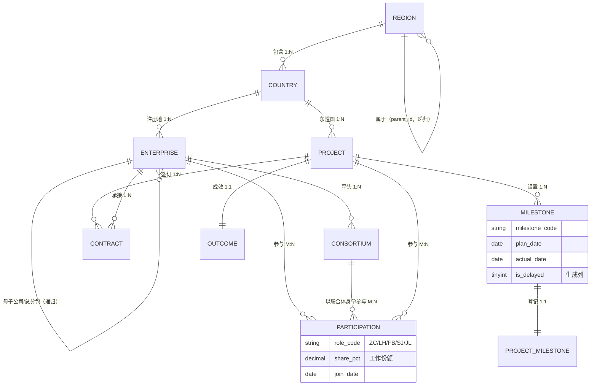
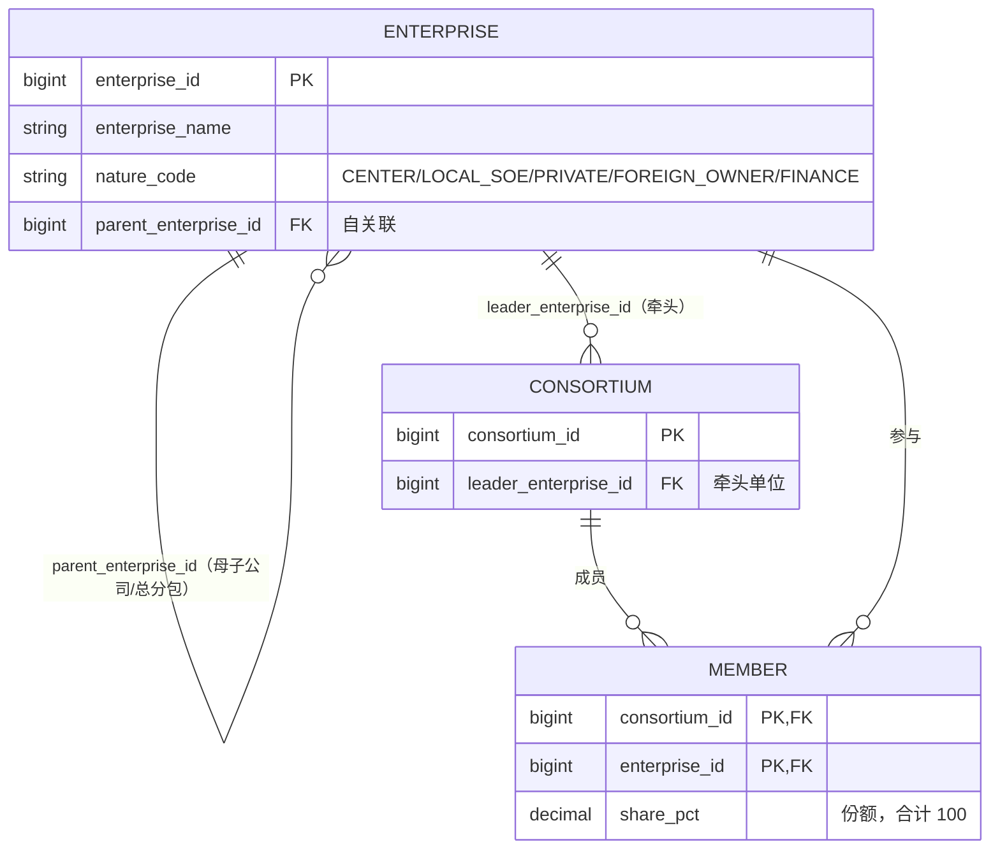
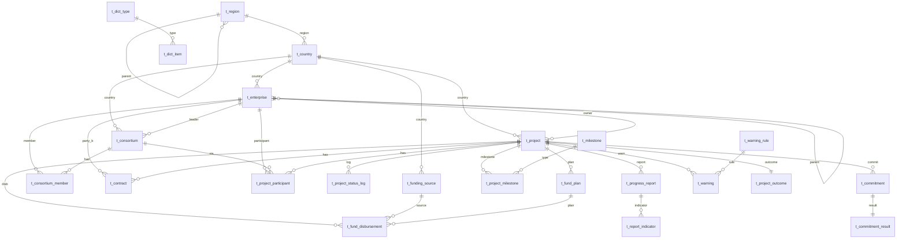

# A-4 · ER 图与关系模式

> 交付物：概念 ER 图（9 类实体 + 全部联系基数）、关系模式（24 张表）、M3 递归联系放大图。
> 图形用 **Mermaid** 编写：GitHub 上直接渲染；要交 PNG，把代码块粘到 <https://mermaid.live> 导出 PNG 即可（也可以在 draw.io 里按同一结构重画）。

## 1. 概念 ER 图（9 类实体）

**读图要点（答辩直接讲）**

| # | 联系 | 类型 | 在图上的位置 | 落地方式 |
| --- | --- | --- | --- | --- |
| 1 | 区域—区域 | 1:N（自关联递归） | `REGION \|\|--o{ REGION` | `t_region.parent_id` 自外键，洲→区域两级 |
| 2 | 国家—项目 | 1:N | `COUNTRY \|\|--o{ PROJECT` | `t_project.country_code` 外键 |
| 3 | 企业—项目 | **M:N（带属性）** | 通过 `PARTICIPATION` 双向 | 关联实体 `t_project_participant`，属性 `role_code/share_pct/join_date` 挂在联系上 |
| 4 | 企业—联合体 | M:N | `CONSORTIUM \|\|--o{ PARTICIPATION` | `t_consortium_member(consortium_id, enterprise_id, share_pct)` |
| 5 | 企业—企业 | 1:N（递归） | `ENTERPRISE \|\|--o{ ENTERPRISE` | `t_enterprise.parent_enterprise_id` 自外键（母子公司/总分包） |
| 6 | 联合体—企业 | “牵头/参与”两条边 | `ENTERPRISE \|\|--o{ CONSORTIUM`（牵头） + 成员表（参与） | `t_consortium.leader_enterprise_id` + `t_consortium_member` |
| 7 | 项目—合同 | 1:N | `PROJECT \|\|--o{ CONTRACT` | `t_contract.project_id` |
| 8 | 项目—里程碑 | 1:N（计划/实际双日期） | `PROJECT \|\|--o{ MILESTONE` | `t_project_milestone.plan_date / actual_date`，`is_delayed` 生成列 |
| 9 | 项目—成效 | 1:1 | `PROJECT \|\|--\|\| OUTCOME` | `t_project_outcome.project_id` 既主键又外键 |

> 规范细节：ER 图里“参与”是**菱形（联系）**，关系模型里必须转成**关联表** `t_project_participant`；联系自身带属性（role_code/share_pct）时，属性只能挂在关联表上，不能挂到项目表或企业表——这是“带属性的多对多”的标准转换。

## 2. M3 联合体与递归联系（放大图）

## 3. 关系模式（24 张表）

记号：<u>主键</u>，*外键*，`UNIQUE`/`CHECK` 列出关键约束。

| # | 关系模式 | 说明 |
| --- | --- | --- |
| 1 | `t_region(<u>region_id</u>, region_code, region_name, *parent_id*, level_no)` | 洲→区域两级，`parent_id` 自外键；`UNIQUE(region_code)` |
| 2 | `t_country(<u>country_code</u>, country_name, country_name_en, *region_id*, is_belt_road, population_k)` | ISO 三字母主键；`CHECK(is_belt_road IN (0,1))` |
| 3 | `t_dict_type(<u>dict_type_id</u>, type_code, type_name, remark)` | `UNIQUE(type_code)` |
| 4 | `t_dict_item(<u>item_id</u>, *dict_type_id*, item_code, item_name, sort_no, enabled)` | `UNIQUE(dict_type_id, item_code)` |
| 5 | `t_user(<u>user_id</u>, username, password_hash, real_name, role_code, enabled, created_at)` | `UNIQUE(username)`；口令 `CHAR(64)` 存 SHA-256 |
| 6 | `t_enterprise(<u>enterprise_id</u>, enterprise_name, enterprise_name_en, nature_code, *country_code*, *parent_enterprise_id*, credit_code, remark)` | 自关联递归 |
| 7 | `t_consortium(<u>consortium_id</u>, consortium_name, *leader_enterprise_id*, *country_code*, establish_date, remark)` | `UNIQUE(consortium_name)` |
| 8 | `t_consortium_member(<u>consortium_id</u>, <u>enterprise_id</u>, share_pct, join_date)` | M:N 带属性；`CHECK(share_pct BETWEEN 0 AND 100)` |
| 9 | `t_project(<u>project_id</u>, project_code, project_name, *country_code*, *owner_enterprise_id*, field_code, mode_code, status, invest_amount, currency_code, sign_date, planned_start_date, planned_end_date, actual_start_date, actual_end_date, remark)` | `UNIQUE(project_code)`；`CHECK(invest_amount>0)`、状态域 |
| 10 | `t_contract(<u>contract_id</u>, *project_id*, contract_no, contract_type, *party_b_enterprise_id*, amount, currency_code, sign_date, remark)` | `UNIQUE(contract_no)`；`CHECK(amount>0)` |
| 11 | `t_project_status_log(<u>log_id</u>, *project_id*, from_status, to_status, change_date, operator, remark)` | 状态轨迹 |
| 12 | `t_project_participant(<u>project_id</u>, <u>enterprise_id</u>, <u>role_code</u>, share_pct, join_date, *consortium_id*)` | 核心 M:N，三列复合主键 |
| 13 | `t_funding_source(<u>source_id</u>, source_code, source_name, source_type, *country_code*, remark)` | `UNIQUE(source_code)` |
| 14 | `t_fund_plan(<u>plan_id</u>, *project_id*, plan_year, plan_amount, currency_code, remark)` | `UNIQUE(project_id, plan_year)` |
| 15 | `t_fund_disbursement(<u>disb_id</u>, *project_id*, *source_id*, *plan_id*, disb_date, disb_amount, currency_code, purpose)` | `CHECK(disb_amount>0)` |
| 16 | `t_milestone(<u>milestone_id</u>, milestone_code, milestone_name, seq_no, planned_days)` | `UNIQUE(milestone_code)` |
| 17 | `t_project_milestone(<u>pm_id</u>, *project_id*, *milestone_id*, plan_date, actual_date, is_delayed, remark)` | `UNIQUE(project_id, milestone_id)`；生成列 |
| 18 | `t_progress_report(<u>report_id</u>, *project_id*, period_ym, progress_pct, output_value, on_site_staff, local_staff, safety_events, quality_events, report_date, remark)` | `UNIQUE(project_id, period_ym)`；进度 0–100 |
| 19 | `t_report_indicator(<u>report_id</u>, <u>indicator_code</u>, indicator_val)` | EAV 多值指标 |
| 20 | `t_commitment(<u>commit_id</u>, *project_id*, commit_type, target_value, compare_op, base_date, clause_text, sign_date, remark)` | 四类承诺；`CHECK(compare_op IN ('<=','>='))` |
| 21 | `t_commitment_result(<u>result_id</u>, *commit_id*, actual_value, gap_value, commit_status, calc_time)` | `UNIQUE(commit_id)` 保证 1:1 |
| 22 | `t_warning_rule(<u>rule_id</u>, rule_code, rule_name, level_code, fund_rate_op, fund_rate_value, progress_op, progress_value, overdue_min, enabled, description)` | 阈值做成数据 |
| 23 | `t_warning(<u>warning_id</u>, *rule_id*, *project_id*, level_code, metric_value, message, status_code, created_at, ack_at, ack_by)` | `UNIQUE(rule_id, project_id, status_code)` 保证刷新幂等 |
| 24 | `t_project_outcome(<u>project_id</u>, beneficiary_k, jobs_created, training_ppl, green_mw, standards_out, update_date, remark)` | 主键即外键，1:1 |

## 4. 关系模型全表图

## 5. 怎么把图变成 PNG（交作业用）

1. 打开 <https://mermaid.live>，把上面任意一个代码块粘进左侧编辑器；
2. 右侧出现图形后，点 **Actions → Download PNG**（想要高清就选 SVG 再转 PNG）；
3. 命名 `A4-ER图-总图.png` / `A4-ER图-M3递归.png` 放进报告第 2 章。

> 若老师要求 PDF/Word 里也清晰，导出 **SVG** 再插入（矢量不失真）。
